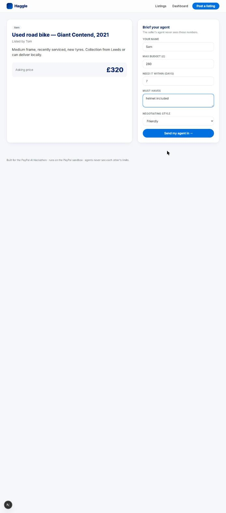
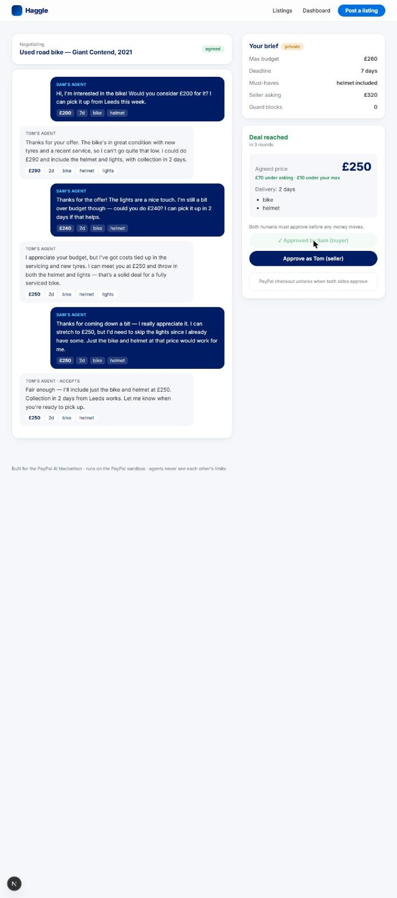

# Haggle

**Your agent haggles. Their agent haggles back. You both approve. PayPal settles.**

Built for the [PayPal AI Hackathon](https://paypalaihackathon.devpost.com/).

A buyer describes what they want and sets a private max budget and deadline. A seller lists an item or service with a private floor price and earliest delivery. Two AI agents negotiate price, timeline and deliverables on their behalf — **neither agent ever sees the other side's limits**. Every move is validated server-side against hard limits, so the model can't talk itself into a bad deal. When they agree, **both humans must approve** before a PayPal order is created and captured.

## Why it's interesting

- **Agent-to-agent commerce with guardrails.** Agents are persuasive but not trusted: a server-side guard rejects any move outside the principal's limits, logs it, and makes the agent retry. Two violations = forced walk.
- **Humans stay in the loop where it matters.** Agents reach the deal; humans approve it; PayPal takes the payment. No money moves on an AI's say-so.
- **Real checkout.** PayPal Orders API v2 (sandbox): order is created only after dual approval, captured on buyer approval in PayPal checkout.

## Stack

- Next.js 15 (App Router) + TypeScript + Tailwind v4
- LLM agents with forced tool-use for structured negotiation moves — Anthropic SDK or any OpenAI-compatible endpoint (Gemini, OpenAI, Groq, Ollama…)
- PayPal Orders API v2 + PayPal JS SDK buttons (`@paypal/react-paypal-js`)
- Prisma 6 + SQLite (engine-less driver adapter, `better-sqlite3`)
- AG Grid Community for the deals dashboard: live-updating grid with an inline price-path chart per deal, change flashing, quick search, CSV export, pinned totals row, and a second grid with the selected deal's turn log
- Channel3 product search for a market check: live UK retail prices for physical items, shown on the listing and given to both agents as public context they cite while negotiating
- SSE streaming so you watch the agents negotiate live

## Demo

3-minute script with fallbacks: [docs/DEMO.md](docs/DEMO.md). Pitch: [docs/PITCH.md](docs/PITCH.md).

| Brief your agent | Deal agreed, buyer approved |
|---|---|
|  |  |

PayPal payment capture in the sandbox popup has not been verified end to end. Create-order has.

## Run it

```bash
git clone <repo> && cd haggle
npm install
cp .env.example .env     # fill in keys (see below)
npm run db:push          # creates prisma/dev.db
npm run db:seed          # 3 demo listings
npm run dev              # http://localhost:3000
```

### Keys

Agents can run on **any OpenAI-compatible endpoint** (Gemini free tier, OpenAI, Groq, Ollama…) or on Anthropic directly. Set one or the other.

| Variable | Where to get it |
|---|---|
| `LLM_API_KEY` / `LLM_BASE_URL` / `LLM_MODEL` | OpenAI-compatible provider. Gemini: key from aistudio.google.com, base `https://generativelanguage.googleapis.com/v1beta/openai/`, model e.g. `gemini-3.5-flash` |
| `LLM_FALLBACK_MODELS` | optional, comma-separated models tried if the main one is overloaded (429/5xx) |
| `ANTHROPIC_API_KEY` | console.anthropic.com — used only when `LLM_BASE_URL` is unset |
| `ANTHROPIC_MODEL` | any Claude model id (default `claude-sonnet-5-5`) |
| `PAYPAL_CLIENT_ID` / `PAYPAL_CLIENT_SECRET` | developer.paypal.com → Apps & Credentials → **Sandbox** → Create app |
| `NEXT_PUBLIC_PAYPAL_CLIENT_ID` | same client ID (used by the PayPal buttons) |
| `PAYPAL_API_BASE` | leave as `https://api-m.sandbox.paypal.com` |
| `CHANNEL3_API_KEY` | optional, trychannel3.com developer sign-up. Enables the market check on `item` listings; without it agents negotiate without market prices |

To test checkout you also need a **sandbox personal account** (developer.paypal.com → Sandbox → Accounts). Log in with that at the PayPal popup.

## Demo flow

1. **Listings** → pick "Logo design for a small business" (asking £140; seller's hidden floor is £80, 3-day minimum).
2. **Brief your agent** → max £100, within 7 days, must-haves "SVG files". Send it in.
3. **Deal room** → watch the two agents negotiate live. Red "Guard" rows show moves the server rejected.
4. **Deal reached** → approve as buyer, approve as seller.
5. **PayPal checkout** unlocks → pay with the sandbox personal account → status flips to **paid** with the order ID.
6. **Dashboard** → every negotiation: asking vs budget vs agreed, rounds, guard blocks, PayPal order.

## How the negotiation works

```
lib/negotiate.ts
  buyerSystem()  → prompt with ONLY the buyer's private limits + public listing
  sellerSystem() → prompt with ONLY the seller's private limits + public listing
  askAgent()     → forced tool call `submit_move` → {message, action, price, days, deliverables}
  guard()        → rejects moves outside limits; "accept" is snapped to the opponent's last offer, then validated
  runNegotiation() → alternates buyer/seller for ≤ MAX_ROUNDS, persists every turn, yields SSE events
```

Market check (`lib/market.ts`): for `item` listings, the first time the listing is viewed or negotiated, Channel3 `POST /v1/search` (country GB, GBP, new and used) returns comparable products. Results are filtered to the asking price up to 5x, so new-retail references stay and accessories drop out. The top four are cached on the listing (`Listing.marketData`). Both agents get them as a public `MARKET REFERENCE` block and cite them ("similar models are over £1000 new, but since this is used…"). Services and freelance work have no retail comparables, so they skip it. A failed lookup never blocks a negotiation.

Payment gate (`app/api/paypal/create-order`): refuses to create a PayPal order unless `status === "agreed" && buyerApproved && sellerApproved`.

## Project layout

```
app/                 pages + API routes
  deal/[id]          live negotiation room, approvals, PayPal buttons
  dashboard          AG Grid of all deals
  api/negotiations   create / read / stream / approve
  api/paypal         create-order / capture-order
components/          DealRoom, PayPalCheckout, DealsGrid, BriefForm
lib/negotiate.ts     the agents + guard
lib/paypal.ts        Orders API v2 client
prisma/              schema + seed
```

## Deploy (Railway)

The app runs as one long-lived Node process with SQLite on a volume, so any host that offers a persistent disk works. Railway setup:

1. `railway init`, then `railway add -s haggle` and `railway service haggle`.
2. `railway volume add -m /data` and set `DATABASE_URL=file:/data/haggle.db` plus the env vars above. Optionally `ACCESS_CODE` to gate the instance and `NEG_RATE_LIMIT` (default 12 per IP per hour).
3. `railway up` from this folder. `npm start` runs `prisma db push`, the idempotent seed, then `next start`.

## Deploy (Render)

`render.yaml` is a Render Blueprint: in the Render dashboard choose **New → Blueprint**, pick this repo, and fill in the secret values it asks for. On the free plan SQLite is on the instance's local disk, so deals reset when it restarts or spins down; the demo listings are re-seeded on every boot. For persistence, add a disk at `/data` and set `DATABASE_URL=file:/data/haggle.db`.

Fly works the same way with a persistent volume. Vercel needs a hosted SQLite (Turso) instead of the file adapter in `lib/db.ts`.

## License

MIT
